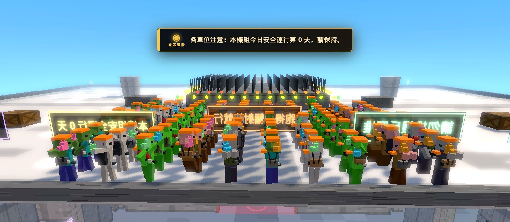

# 大番薯网站：自己上传、自己改

这份是给你自己操作的。不用找人代改。改完等一两分钟，再强制刷新网页。

## 你的地址

给朋友玩，发这个：

https://ka-by.github.io/dabanshu/

- 直接玩游戏：https://ka-by.github.io/dabanshu/play.html
- 玩法介绍：https://ka-by.github.io/dabanshu/guide/
- 改文件的仓库（不要发给朋友）：https://github.com/ka-by/dabanshu

仓库是公开的。别人能打开网站，也能看见里面的文件。不要把密码、邮箱、身份证、密钥放进去。

## 文件夹对照

| 你要改的东西 | 打开这个文件 |
|---|---|
| 大厅标题、按钮、游戏格子 | `index.html` |
| 玩游戏时顶上那一条 | `play.html` |
| 玩法介绍 | `guide/index.html` |
| 大厅背景大图 | `assets/hero-roof.jpg` |
| 中英文切换用的字 | 各页里带 `data-zh` 和 `data-en` 的那一行 |
| 游戏本体 | `game/` 整个文件夹 |

游戏程序在 `game/js/`。没有把握时不要删这些文件：`game.js`、`map.js`、`weapons.js`、`bots.js`、`three.min.js`。

## 每次改完都用这一套

1. 用浏览器打开 https://github.com/ka-by/dabanshu ，确认自己登录的是 `ka-by`。
2. 点进要改的文件。
3. 右上角铅笔图标（Edit this file）改字；或回到仓库首页，点 **Add file → Upload files** 上传图片、新游戏文件夹。
4. 页面最下面 **Commit changes**。说明写一句人话，例如「换了大厅图片」。
5. 分支保持 **main**。不要改成别的分支。绿色按钮点下去。
6. 等一两分钟。打开网站，按 `Ctrl + F5`（苹果电脑是 `Command + Shift + R`）。

上传时如果问你要不要新建分支，选直接提交到 `main`。

## 只改大厅上的字

打开 `index.html`，搜索你看见的那句中文。同一行里有两段：

- `data-zh="..."` 中文
- `data-en="..."` 英文

两段一起改。只改中文的话，别人点右上角 **EN** 还会看到旧英文。

游戏里面的菜单、武器名、提示，现在还是中文。右上角的中英文只切换大厅、介绍页和玩游戏顶栏。

## 换大厅那张天台大图

1. 新图片用电脑改名为 `hero-roof.jpg`。名字必须一模一样，包括大小写。
2. 仓库里点进 `assets`。
3. **Add file → Upload files**，把这张图拖进去。
4. GitHub 会问是不是替换旧文件，确认替换。
5. 提交到 `main`，然后强制刷新首页。

介绍页的图片在 `guide/img/`，换哪张就用哪张原来的文件名。

## 以后再放一款新游戏

新游戏做成一个文件夹，里面要有 `index.html`，能用浏览器直接打开。文件夹名用英文，例如 `game2`。不要用中文名，不要有空格。

1. 在仓库首页 **Add file → Upload files**。
2. 把整个 `game2` 文件夹拖进去，提交到 `main`。
3. 打开 `index.html`，找到「即将上架」那一格，整格换成下面这样（名字和链接改成你的）：

```html
<a class="slot" href="game2/">
  
  <div>
    <div class="live" data-zh="可玩" data-en="PLAYABLE">可玩</div>
    <strong data-zh="新游戏名字" data-en="New Game Name">新游戏名字</strong>
    <span data-zh="一句话介绍" data-en="One line about it">一句话介绍</span>
  </div>
</a>
```

4. 提交到 `main`，强制刷新。

玩家从大厅点进去，会直接打开 `game2/index.html`。如果也想套进现在的顶栏（有返回大厅），再说，那一页要单独做。

## 这些不要做

- 不要把密码、令牌、邮箱、身份证传进仓库。
- 不要删 `game/js` 里的程序，除非你有一份完整备份。
- 不要上传很大的录像。图片尽量压到每张几百 KB。
- 大陆能不能打开，取决于对方网络能不能连上 `github.io`。不注册新域名、新服务器的话，换不了这个限制。
